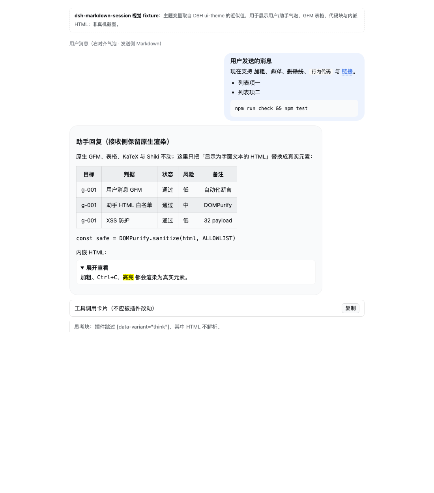

# dsh-markdown-session

DSH Web GUI 的会话 Markdown 渲染插件（客户端增强，单包双半边）：

- **用户消息（发送侧）**：接管 `conversation.user.text.node` key=`text` 子槽，用 marked(GFM) 渲染 Markdown，代码块等宽、表格边框/斑马纹、宽表横向滚动。
- **助手消息（接收侧）**：不接管 React 渲染树，保留原生 GFM / 表格 / KaTeX / Shiki；用 DOM 后处理把「显示为字面文本的白名单 HTML」替换成清洗后的真实元素（`<details>`、`<kbd>`、`<table>`…）。
- **XSS 防护**：所有消息内容视为不可信。DOMPurify 强白名单（标签 + 属性 + URI 正则 + `afterSanitizeAttributes` 钩子），没有 sanitizer 时失败关闭。
- **聊天气泡**：用户右对齐、助手左对齐；浅/深色都使用 DSH 主题变量。
- **可逆卸载**：禁用插件后移除样式、根属性、MutationObserver，并把已替换的 HTML 还原成字面文本。




> 截图来自 `test/fixtures/visual.html` 的**视觉 fixture**：真浏览器渲染，但主题变量是 DSH `ui-theme` 的近似值，用于展示布局与可读性，不是真机像素级截图。

## 安装

本包按 DSH 插件规范组织（`package.json` 的 `dsh.bundle.patch` + `dsh.client`、`cordis.patch.yml`、客户端半区 `client.js`、`locale/`、`icon.svg`、`LICENSE`）。

```bash
# 1) 链接进 web profile（本地开发路径）
dsh plugin --profile web add link:/absolute/path/to/plugins/dsh-markdown-session

# 2) 把包名加入 profile 的 bundle 列表：~/.dsh/profiles/web/package.json
#    "dsh": { "profile": { "bundles": [ ..., "dsh-markdown-session" ] } }

# 3) 重启 dsh web（或按 profile 的热重载方式重载）
```

卸载：从 `bundles` 移除并 `dsh plugin --profile web remove dsh-markdown-session`，刷新页面即恢复原样（插件自身也提供完整 dispose 路径）。

## 工作原理

### 用户消息

`ui-conversation` 的工厂槽 `conversation.user.text` 不可覆盖，但它把正文交给 keyed 子槽 `conversation.user.text.node`（key=`text`，priority=100）。本插件用 **priority=90** 注册同 key 渲染器（keyed 槽同 key 不同 priority 合法，最低 priority 渲染），并保留 session 引用等其它 key 的原生渲染。

管线固定为：

```
marked.parse(text, { gfm: true })  →  DOMPurify.sanitize(html, 白名单)  →  dangerouslySetInnerHTML
```

清洗后的字节只来自 `sanitize` 的返回值，之后不再拼接任何 HTML。队列预览（`ellipsis`）在检测到父容器 `text-overflow: ellipsis` 时降级为单行纯文本。

### 助手消息

只处理 `[data-chat-flow-kind="assistant-step"] [data-text-interaction-source]`（该属性只出现在 settled 的最终消息上），MutationObserver 去抖 300ms。遍历文本节点，遇到含白名单标签的字面文本时：

```
template.innerHTML = text（惰性，不执行脚本）→ DOMPurify.sanitize → 插入片段替换文本节点
```

跳过 `pre/code/textarea/script/style/[data-code-block-content]/[data-variant="think"]/.katex/[contenteditable]`；替换后的顶层元素打 `data-dsh-md-html` 标记，扫描时跳过以防回环。每条替换都有记录，`dispose()` 时按逆序还原原文。

**流式期间不动**；HTML 在消息落定后替换。

### 气泡与表格

全部规则以 `html[data-dsh-md-session="on"]` 作用域注入，禁用即失效：

- 用户行右对齐、助手行左对齐（不改 `[data-chat-flow-kind]` 行结构、不设 `transform`，避免破坏 viewport 测量与 sticky 代码 banner）。
- 助手正文根加背景/圆角/内边距/最大宽度，颜色取 `--dsw-alias-markdown-code-block`、`--dsw-alias-label-primary` 等主题变量，浅/深色自动适配。
- 表格统一边框 + 斑马纹（用户侧、内嵌 HTML、助手原生表格）。
- 宽表 `.md-table-wide` 的「破栏负 margin」在气泡内改为**气泡内横向滚动**（`overflow-x:auto`），不撑破页面宽度。

### XSS 白名单

- `ALLOWED_TAGS`：`a abbr b blockquote br caption code dd del details div dl dt em h1-h6 hr i img ins kbd li mark ol p pre q s samp small span strong sub summary sup table tbody td tfoot th thead tr u ul var wbr`。
- `ALLOWED_ATTR`：`href title alt src open align colspan rowspan scope datetime start reversed value cite dir lang width height`（无 `style`、无事件属性、无 `id/name/class`）。
- `FORBID_TAGS`：script/style/link/meta/base/iframe/object/embed/form/input/button/select/textarea/svg/math/template/noscript/video/audio/... 双保险。
- URI：`ALLOWED_URI_REGEXP` 仅 http(s)/mailto/相对/锚点；`afterSanitizeAttributes` 再校验 `href`、`src`（图片限 http(s)/`data:image` 位图 base64），并给链接补 `rel="noopener noreferrer"`。
- `ALLOW_DATA_ATTR`/`ALLOW_ARIA_ATTR` 关闭；无 sanitizer（或 marked 缺失）时回退为转义纯文本，绝不直出原文。

## 开发与验证

```bash
npm run check   # 语法检查（client.js / index.js / build / lib）
npm test        # 构建 + node:test（单元 + 真浏览器 E2E）
```

- `test/unit.test.mjs`：GFM 结构、管线顺序、白名单配置、URL 策略、apply/dispose、组件输出、bundle 形态。
- `test/browser.test.mjs`：无头 Chrome（`DSH_CHROME_PATH` 可覆盖路径；找不到时跳过）加载 `test/fixtures/harness.html`，验证 30+ XSS payload 零执行、字面 HTML 替换与还原、气泡对比度（WCAG ≥4.5）、宽表滚动、工具卡/按钮负向回归，并生成浅/深色视觉截图。
- `node scripts/build.mjs`：把 `vendor/marked.umd.cjs`、`vendor/purify.cjs.js` 与 `lib/markdown-session.cjs` 内联成 classic script `client.js`（浏览器官网只共享 11 个静态模块，loader 不解析 bare 包；只有 `react` 走宿主静态表）。

### 已知限制

- 助手侧 HTML 是**后处理**：流式期间仍显示字面文本，落定后替换；块级可靠，行内按白名单标签尽力。
- 极端情况下 React 重新渲染 settled 消息会覆盖后处理结果，下一个观察周期会重新处理。
- 本 attempt 的执行环境无法把插件安装进 `~/.dsh/profiles/web`（沙箱只允许写工作区），因此**真机 GUI 安装后的最终目视验证由 supervisor 在合并后执行**；仓库内已用无头 Chrome 做真 DOM 验证。

## 第三方

| 包 | 版本 | 许可证 | 用途 |
| --- | --- | --- | --- |
| [marked](https://github.com/markedjs/marked) | 16.4.2 | MIT | 用户消息 GFM → HTML |
| [DOMPurify](https://github.com/cure53/DOMPurify) | 3.4.17 | Apache-2.0 OR MPL-2.0 | 强白名单清洗 |

两者构建产物内联在 `client.js` 中，原始许可证见 `vendor/marked.LICENSE.md`、`vendor/purify.LICENSE`。

## License

MIT（见 [LICENSE](LICENSE)）。
