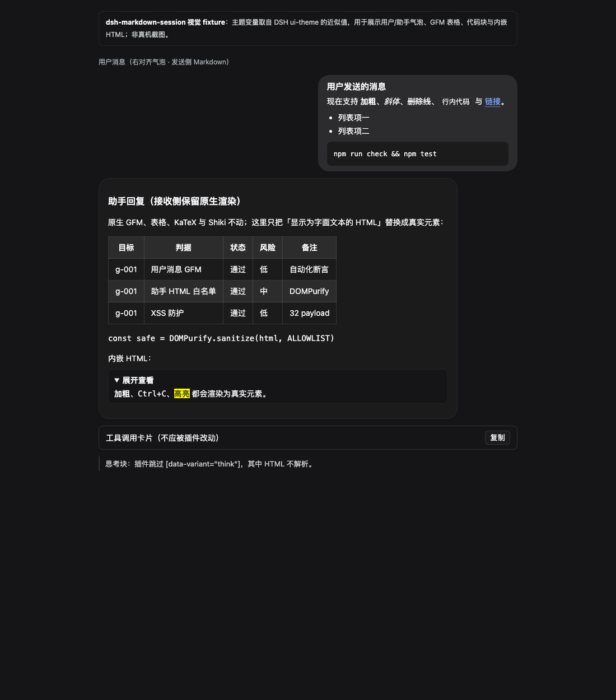

# dsh-markdown-session

DSH Web GUI 的会话 Markdown 渲染插件（客户端增强，单包双半边）：

- **用户消息（发送侧）**：接管 `conversation.user.text.node` key=`text` 子槽，用 marked(GFM) 渲染 Markdown，代码块等宽、表格边框/斑马纹、宽表横向滚动。
- **助手消息（接收侧）**：不接管 React 渲染树，保留原生 GFM / 表格 / KaTeX / Shiki；用 DOM 后处理把「显示为字面文本的白名单 HTML」替换成清洗后的真实元素（`<details>`、`<kbd>`、`<table>`…）。
- **XSS 防护**：所有消息内容视为不可信。DOMPurify 强白名单（标签 + 属性 + URI 正则 + `afterSanitizeAttributes` 钩子），没有 sanitizer 时失败关闭。
- **聊天气泡**：用户右对齐（沿用上游 `.userRow` 结构）、助手左对齐；气泡锚在消息根，**流式与历史中间 step 同样有气泡**（不依赖 settled 才有的属性）；浅/深色都使用 DSH 主题变量。
- **可逆卸载**：禁用插件后移除样式、根属性、MutationObserver，并把已替换的 HTML 还原成字面文本。




> 截图来自 `test/fixtures/visual.html` 的**视觉 fixture**：真浏览器渲染，但主题变量是 DSH `ui-theme` 的近似值，用于展示布局与可读性，不是真机像素级截图。截图不随 npm 包发布（`files` 已排除 `test/`），此处走仓库 raw 链接。

## 安装

本包按 DSH 插件规范组织（`package.json` 的 `dsh.bundle.patch` + `dsh.client`、`cordis.patch.yml`、客户端半区 `client.js`、`locale/`、`icon.svg`、`LICENSE`）。

```bash
# 1) 链接进 web profile（本地开发路径）
dsh plugin --profile web add link:/absolute/path/to/plugins/dsh-markdown-session

# 2) 把包名加入 profile 的 bundle 列表：~/.dsh/profiles/web/package.json
#    "dsh": { "profile": { "bundles": [ ..., "dsh-markdown-session" ] } }

# 3) 重启 dsh web（或按 profile 的热重载方式重载）
```

卸载：从 `bundles` 移除并 `dsh plugin --profile web remove dsh-markdown-session`，刷新页面即恢复原样（插件自身也提供完整 dispose 路径）。

## 工作原理

### 用户消息

`ui-conversation` 的工厂槽 `conversation.user.text` 不可覆盖，但它把正文交给 keyed 子槽 `conversation.user.text.node`（key=`text`，priority=100）。本插件用 **priority=90** 注册同 key 渲染器（keyed 槽同 key 不同 priority 合法，最低 priority 渲染），并保留 session 引用等其它 key 的原生渲染。

管线固定为：

```
marked.parse(text, { gfm: true })  →  DOMPurify.sanitize(html, 白名单)  →  dangerouslySetInnerHTML
```

清洗后的字节只来自 `sanitize` 的返回值，之后不再拼接任何 HTML。队列预览（`ellipsis`）在检测到父容器 `text-overflow: ellipsis` 时降级为单行纯文本。

### 助手消息

只处理 `[data-chat-flow-kind="assistant-step"] [data-text-interaction-source]`（该属性只出现在 settled 的最终消息上），MutationObserver 去抖 300ms。

**按相邻文本段整体处理**（不是逐文本节点）：上游 MarkdownText 会把一段 raw HTML 拆成多个相邻 DOM 文本节点（例如 `<details><summary>标题</summary>` 与 `</details>` 之间夹着 md 渲染的 `<strong>`）。逐节点解析会产出空壳 details + 游离 `</summary>`/`</details>`。当前实现：

1. 在同一父节点下把相邻文本节点合并成文本段（兄弟间只允许隔注释）；
2. 段内 HTML 已闭合 → `template.innerHTML`（惰性，不执行脚本）→ `DOMPurify.sanitize` → 用一个 marker + 片段替换整段；
3. 段内 HTML 未闭合 → 向后拼接兄弟文本/元素：元素用 token 占位，清洗成功后把**原 React 节点**接回（保留节点身份与事件），直到标签闭合；遇到受保护元素或到父节点末尾仍不闭合则整段放弃，保持字面显示（宁可字面，不产出错位结构）。

跳过 `pre/code/textarea/script/style/[data-code-block-content]/[data-variant="think"]/.katex/[contenteditable]`；替换后的顶层元素打 `data-dsh-md-html` 标记，扫描时跳过以防回环。每条替换记录 `{ marker, originals, insertedRoots }`，`dispose()` 时逆序把整段原节点（含被拼接的元素）按原顺序插回。

**流式期间不动**；HTML 在消息落定后替换。

### 气泡与表格

全部规则以 `html[data-dsh-md-session="on"]` 作用域注入，禁用即失效：

- 助手气泡锚在 **AssistantMarkdown 根 div**：`[data-chat-flow-kind="assistant-step"] > [data-slot="conversation.chat.node"] > div`（行 → slot 锚点 → 消息根）。该根在流式（`data-streaming`）与历史中间 step 上同样存在，所以气泡不等落定；气泡因此同时包住 reasoning / images 子块。
- 不向 `[data-chat-flow-kind]` 行容器注入任何布局属性（行不是 flex 容器）：用户右对齐来自上游 `.userRow{align-items:flex-end}`，助手左对齐来自 `.body{flex-direction:column}` + 根 div 的 `width:fit-content`。
- **布局稳定化（流式跟随修复）**：气泡的几何（`padding:12px 16px`、`border` 宽度、`width:fit-content`、`max-width`、`box-sizing`、圆角）**恒定**挂在消息根上，与内容状态无关；只有 `background` / `border-color` 由内容条件化。流式内容从「无」到「有正文」时行高只增长内容高度，不再出现 padding/border/折行宽度造成的阶跃 —— 上游 `use-chat-reading` 会把尺寸突变触发的浏览器 scroll anchoring 补偿误判成读者滚动，挂起采样并停掉 `followingTail`，视图就会停在上一条回复。
- **只有存在可见内容才出气泡**：`root div:has(> body > *:not([hidden]):not(:empty))`（含可见 reasoning / 过程包装），并排除 `data-chat-group-part="reasoning"` 分区行。折叠思考、空 body（仅 tool-call）的 step 只有透明的恒定几何、没有可见气泡；流式期间一旦有正文或可见 reasoning 立即显形。
- 不设 `transform`、不给气泡根设 `overflow:hidden`，避免破坏 sticky 代码 banner；`.body` 的 16px gap 与折叠隐藏行为保持不变。
- 颜色取 `--dsw-alias-markdown-code-block`、`--dsw-alias-label-primary` 等主题变量，浅/深色自动适配。
- 表格统一边框 + 斑马纹（用户侧、内嵌 HTML、助手原生表格）；助手表格的边框/内边距**不依赖 settled 标记**，流式期已是真实 `<table>` 就先应用，落定瞬间不再整表增高。
- 宽表 `.md-table-wide` 的「破栏负 margin」在气泡内改为**气泡内横向滚动**（`overflow-x:auto`），不撑破页面宽度。

### XSS 白名单

- `ALLOWED_TAGS`：`a abbr b blockquote br caption code dd del details div dl dt em h1-h6 hr i img ins kbd li mark ol p pre q s samp small span strong sub summary sup table tbody td tfoot th thead tr u ul var wbr`。
- `ALLOWED_ATTR`：`href title alt src open align colspan rowspan scope datetime start reversed value cite dir lang width height`（无 `style`、无事件属性、无 `id/name/class`）。
- `FORBID_TAGS`：script/style/link/meta/base/iframe/object/embed/form/input/button/select/textarea/svg/math/template/noscript/video/audio/... 双保险。
- URI：`ALLOWED_URI_REGEXP` 仅 http(s)/mailto/相对/锚点；`afterSanitizeAttributes` 再校验 `href`、`src`（图片限 http(s)/`data:image` 位图 base64），并给链接补 `rel="noopener noreferrer"`。
- `ALLOW_DATA_ATTR`/`ALLOW_ARIA_ATTR` 关闭；无 sanitizer（或 marked 缺失）时回退为转义纯文本，绝不直出原文。

## 开发与验证

```bash
npm run check   # 语法检查（client.js / index.js / build / lib）
npm test        # 构建 + node:test（单元 + 真浏览器 E2E）
```

- `test/unit.test.mjs`：GFM 结构、管线顺序、白名单配置、URL 策略、apply/dispose、组件输出、bundle 形态。
- `test/browser.test.mjs`：无头 Chrome（`DSH_CHROME_PATH` 可覆盖路径；找不到时跳过）加载 `test/fixtures/harness.html`，验证 32 条 XSS payload 零执行、**跨文本节点混合 HTML（details+summary+kbd+md 加粗）**替换与逐字还原、**流式态/落定态两种气泡**、**折叠思考/空 body 不出可见气泡但几何恒定**、**可见 reasoning 已显形**、**布局稳定化（无内容→有正文时 padding/border 不变、高度增量仅来自内容）**、气泡对比度（WCAG ≥4.5）、宽表滚动、行容器布局不被注入、工具卡/按钮负向回归，并生成浅/深色视觉截图。
- `node scripts/build.mjs`：把 `vendor/marked.umd.cjs`、`vendor/purify.cjs.js` 与 `lib/markdown-session.cjs` 内联成 classic script `client.js`（浏览器官网只共享 11 个静态模块，loader 不解析 bare 包；只有 `react` 走宿主静态表）。

### 已知限制

- 助手侧 HTML 是**后处理**：流式期间仍显示字面文本，落定后替换。跨文本节点合并已覆盖 details/kbd/加粗混排；但若 HTML 块跨到受保护元素（代码块/思考块/KaTeX）或无法在父节点内闭合，整段保持字面显示。
- 极端情况下 React 重新渲染 settled 消息会覆盖后处理结果，下一个观察周期会重新处理。
- 空内容 / 折叠思考 / 仅 tool-call 的 step 保留 26px 透明恒定几何（无可见气泡，但占位）；这是「布局不突变」的代价，用来换掉流式跟随失效。
- 真机验收已完成（0.1.0）：用户侧 Markdown/HTML、助手侧跨节点 HTML、XSS 不弹窗、禁用可逆，以及「后台任务 + 多轮交错 + 长回复」下的流式跟随，均在真实 DSH Web GUI 上目视确认。

## 第三方

| 包 | 版本 | 许可证 | 用途 |
| --- | --- | --- | --- |
| [marked](https://github.com/markedjs/marked) | 16.4.2 | MIT | 用户消息 GFM → HTML |
| [DOMPurify](https://github.com/cure53/DOMPurify) | 3.4.17 | Apache-2.0 OR MPL-2.0 | 强白名单清洗 |

两者构建产物内联在 `client.js` 中，原始许可证见 `vendor/marked.LICENSE.md`、`vendor/purify.LICENSE`。

## License

MIT（见 [LICENSE](LICENSE)）。
